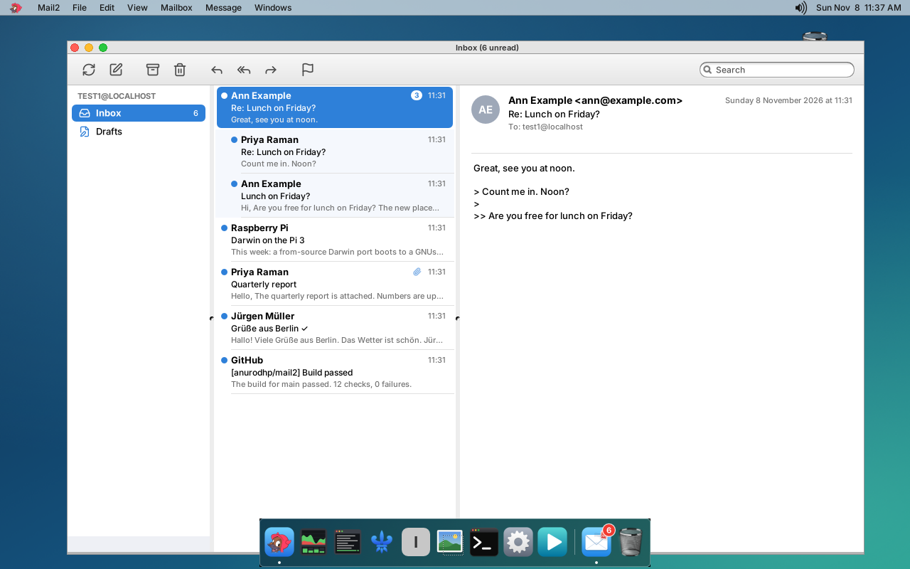

<p align="center"></p>

# Mail2

**A mail client for a small Darwin desktop.** Mail2 is the mail app for the GNUstep + Window Maker desktop on the Raspberry Pi 3 port of Darwin/XNU (the sibling repository [iokit](https://github.com/anurodhp/xnu-iokit-pi3)), next to [Milan](https://github.com/anurodhp/milan), [Naples](https://github.com/anurodhp/naples), [Venice](https://github.com/anurodhp/venice), [Rome](https://github.com/anurodhp/rome) and [Florence](https://github.com/anurodhp/florence). It follows on from GNUstep's GNUMail and is laid out like Apple Mail: mailboxes, the message list and the message, side by side. Pure AppKit + libdispatch on libraries: [libetpan](https://github.com/dinhvh/libetpan) for IMAP, SMTP and MIME, SQLite for the index, Maildir files for the messages, Mbed TLS for TLS, Hunspell for spelling, and Florence's WebKit for HTML mail.

## What you can do

**Accounts.** Any IMAP account: the servers are filled in from the address (Gmail, iCloud, Fastmail, Yahoo, Outlook.com, else `imap.`/`smtp.` on its domain), and Sign In checks them before saving.

- Sign in with a password (or app password), or with **OAuth** for Google and Microsoft (see OAuth below). Google opens its page in the browser; Microsoft shows a code to enter at microsoft.com/devicelogin, on the Pi or a phone.
- Several accounts: Mail2 > Accounts… (Cmd-,) lists them with Add, Edit and Remove. With more than one there is an **All Inboxes** mailbox, and every action goes to each message's own account.
- Each account can have a signature and other addresses to send from (aliases); a reply comes from the address the message was sent to.

**Reading.** Three panes: mailboxes with unread counts (Inbox, Drafts, Sent, Archive, Junk, Trash first, then your folders), the messages (unread dot, flag, sender, date, subject, opening lines, paperclip), and the message.

- **Conversations**: each conversation is one row with its count; selecting it shows all its messages in the message pane, oldest first, each reply without the quote of what it answers. View > Organize by Conversation turns this off.
- **HTML mail** is shown in WebKit (Florence's), sealed: no JavaScript, and nothing from the web until you click Load Remote Content, which then loads it through Florence's tracker list. Without Florence, HTML is shown as text.
- Plain-text mail has its quote levels coloured, the signature dimmed and addresses as links. Pictures attached to it show under the text.
- **Attachments**: a click previews pictures and text files, else offers Save or Open with the desktop's app for it; drag one out to put it in a folder.
- **Smart mailboxes** at the top of the sidebar: Unread, Flagged, Follow Up, the Outbox, and searches you save.
- **Search** (Cmd-F): words, plus `from:`, `to:`, `subject:`, `has:attachment`, `is:unread`, `is:read`, `is:flagged`, `before:2026-11-01` and `after:` — in what is here at once, then on the server, which also finds older mail. Mailbox > Save Search as Smart Mailbox keeps one.
- **Unsubscribe** button for mail with List-Unsubscribe (one-click where the list offers it). **Mute Conversation**: its replies arrive read. **Block Sender**: their mail goes to the Trash.
- Message > Show Raw Source. Scrolling to the end of a mailbox fetches the mail before the first sync's 30 days.

**Writing.** New Message, Reply, Reply All and Forward (with the original's attachments), To, Cc and Bcc.

- **Rich text** (Format menu): bold, italic, underline, sizes, links (Cmd-K), bulleted and numbered lists, quote levels, pictures in the text. Sent as plain text and HTML when there is formatting; Format > Make Plain Text for plain.
- **Spelling** as you type (Hunspell, en_US), with suggestions and Learn Spelling on a right-click.
- Addresses complete as you type, from the people in your mail.
- **Attach** with Attach… or by dropping files on the message.
- **Undo Send** for 5 seconds, **Send Later** at a time you choose, and **Remind Me If No Reply** (listed in Follow Up if nobody answers).
- Everything goes through an **Outbox** kept on disk: mail written offline, or refused, is sent when it can be.
- **Drafts** on the server: Save as Draft (Cmd-S), every minute while editing, and on closing; reopen one from Drafts with Return.

**Organizing.** Archive, Delete, Flag, Mark as Read/Unread, Mark as Junk, Move To… (or drag onto a mailbox), all shown at once and done on the server in the background; **Edit > Undo** takes moves back.

- **Snooze**: the message goes to a Snoozed mailbox on the server and comes back, unread, at the time chosen.
- **Rules** (Mail2 > Rules…): when From, To, Subject or any of them contains a text, move, mark read, flag or trash new mail. **Put on Server** turns them into a Sieve script so the server runs them while Mail2 is closed (Dovecot, Fastmail; not Gmail or iCloud).
- **Folders**: New, Rename and Delete Mailbox, names in any script. **Gmail labels** are shown on a message, and Label As… adds one.

**Staying in sync.** New mail is pushed to the Inbox (IMAP IDLE), every other folder is checked every 2 minutes, and Get Mail checks now. On servers with CONDSTORE a resync fetches only what changed.

**On the desktop.** The unread count of the Inboxes is a badge on Mail2's icon in Naples' dock. `mailto:` links from Milan and Florence open a message to write.

## What you cannot do (yet)

- No contacts (addresses complete from your mail only), no calendar invitations, no S/MIME or PGP, no Exchange or JMAP: IMAP and SMTP only.
- No new-mail notifications beyond the dock badge.
- OAuth needs client IDs of your own (below); iCloud and Yahoo use app passwords.
- Conversations are per mailbox and made from References and In-Reply-To only.
- Rules have one condition each. Search in All Inboxes covers only what is downloaded.
- Remote content in HTML mail is loaded only through Florence's tracker list, which cannot know every sender's own tracking pixel; that is why it stays off by default.
- Passwords and OAuth tokens are kept in `~/GNUstep/Library/Mail2/Accounts.plist` (mode 600): there is no keychain on this system.
- Emoji outside the BMP show as `?`, as in Milan. Spelling is English only.
- Building needs a Mac and the iokit toolchain. There is no prebuilt package.

## How it works

Each account has a serial dispatch queue that owns one IMAP connection; every command runs there, in order, and results reach the main thread with `performSelectorOnMainThread:` (the main dispatch queue does not wake GNUstep's run loop). Changes are written to the index first, so the window shows them before the server hears of them.

- **TLS**: libetpan's TLS is OpenSSL or GnuTLS, which this system does not have. It takes any transport as a `mailstream_low` driver, so `Mail2TLS.c` is one on Mbed TLS, verifying against `/etc/ssl/cert.pem` and the host name; STARTTLS swaps it in on the same socket. ChaCha20-Poly1305 comes first (the Pi 3's Cortex-A53 has no AES instructions), and sessions and TLS 1.3 tickets are kept per server, so a reconnection skips the certificate chain. A plain-socket driver of its own retries reads interrupted by signals, which on this system reach every thread.
- **Logins**: AUTH PLAIN/LOGIN and XOAUTH2 are written on libetpan's streams, as its SMTP AUTH needs Cyrus SASL, which this system does not have. OAuth tokens come over HTTPS through the same Mbed TLS stream.
- **Store**: `~/GNUstep/Library/Mail2/Index.sqlite` has a row per mailbox and per message (envelope, flags, snippet, conversation key, the name of its file); downloaded messages are files in a Maildir per mailbox, renamed when their flags change. Bodies go into an FTS4 table for search. The list reads only the index; conversations are one query with window functions.
- **Sync**: the first time, the last 30 days (at most 500 messages); then only UIDs above the highest known, and the flags of the known ones — with CONDSTORE only the ones changed since the last sync. A second connection IDLEs on the Inbox in a thread of its own, and while it is live the Inbox is not resynced on a clock. Every 2 minutes (one wakeup for all accounts) the other folders are checked: in one LIST-STATUS command where the server has it (Dovecot, Fastmail), else a STATUS each.
- **Waking up**: the Outbox, snooze and follow-ups each set one timer, for the next thing due, and none when nothing is waiting. Large message files are mapped rather than read, and SQLite reads its index through a mapping too, so both come from the kernel's file cache.
- **HTML**: `libFloWeb`, Florence's engine glue as a shared library, is `dlopen`ed the first time an HTML message is shown, so Mail2 starts no WebKit until then and nothing without Florence. Its `FloWebView` is sealed: no JavaScript, an ephemeral network session behind a proxy that does not exist, `cid:` images served from the message. Load Remote Content remakes it with a network session of its own and Florence's content-blocker list.
- **Outgoing mail**: the compose window builds the message (plain text, or plain text and HTML from the formatted text, pictures by `cid:`) with libetpan's MIME writer and hands it to the Outbox, which sends it through the account's queue when it is due and keeps it on disk until the server takes it.
- **GNUstep on this desktop**: it redraws only after an event, so Mail2 posts one after background results; its Tab order is not used, so the compose window and account panel set their own.
- **Badge**: after every change Mail2 posts the distributed notification `NaplesBadgeChanged`, which Naples draws on the icon (it needs `gdnc`, which the session starts).

## OAuth

Google and Microsoft give mail access only to applications registered with them, so Mail2 uses client IDs you register (free, and not shipped in Mail2).

- **Google**: in the Google Cloud console, create a project, enable the Gmail API, set up the consent screen (with yourself as a test user) and create an OAuth client of type *Desktop app*. Then `defaults write Mail2 Mail2GoogleClientID <id>` and `defaults write Mail2 Mail2GoogleClientSecret <secret>`.
- **Microsoft**: in Microsoft Entra (App registrations), register an application for personal and organizational accounts, allow public client flows, and add the delegated permissions `IMAP.AccessAsUser.All`, `SMTP.Send` and `offline_access`. Then `defaults write Mail2 Mail2MicrosoftClientID <id>`.

Google's sign-in is the authorization-code flow with PKCE, the browser coming back to a one-time listener on 127.0.0.1; Microsoft's is the device-code flow. Either ends with a refresh token kept with the account; access tokens are fetched when needed and kept in memory. Microsoft's new refresh token after each renewal is saved at once.

## Building

You need a Mac with **Xcode 12** (the iPhoneOS SDK the port is built with) and a current Xcode for its linker, and the [iokit](https://github.com/anurodhp/xnu-iokit-pi3) repository checked out next to this one (`../iokit`, or set `IOKIT_DIR`) with its toolchain, X11, GNUstep and Mbed TLS already built.

```sh
./build.sh            # builds libetpan, SQLite and Hunspell if needed (iokit's scripts), then Mail2.app
./build.sh deploy     # build, then copy Mail2.app and its libraries to the Pi
```

`deploy` uses `DEPLOY_HOST` (default `root@10.0.0.142`) and stops a running Mail2 first. The dock badge needs Naples v0.10 or later; HTML mail in WebKit needs Florence with `libFloWeb` on the Pi (without it Mail2 shows HTML as text).

## Testing

```sh
tests/run_host_tests.sh   # the mail core, natively on the Mac, against a real IMAP/SMTP server (GreenMail; needs java and cmake)
tools/qemu_shots.sh       # the app on the Darwin desktop under QEMU, with screenshots in docs/
```

`run_host_tests.sh` builds libetpan, Mbed TLS and Hunspell for the Mac from iokit's pinned sources, compiles Mail2's own core with Apple's Foundation and runs 171 checks against GreenMail (fetched once, pinned by checksum), with small stand-ins for the OAuth providers (`tests/oauth_mock.py`) for ManageSieve (`tests/sieve_mock.py`) and for an IMAP server with LIST-STATUS (`tests/imap_list_status_mock.py`): TLS, logins, sync and IDLE, MIME and HTML, sending, drafts, the Outbox, rich text, spelling, search, conversations, rules, snooze, folders, and more. `qemu_shots.sh` boots the real desktop under QEMU and drives Mail2 against GreenMail on the host: syncing, conversations, search, reopening a draft and sending it, typing and sending a new message, HTML mail in WebKit, and two accounts.

As of November 8, 2026 (version 0.9) Mail2 runs on a real Pi 3 with Naples and Florence; it has not yet been used with a real Google or Microsoft account, nor tested against a server with CONDSTORE. On the Pi, `MAIL2_DEBUG=1 /Applications/Mail2.app/Mail2` logs the IMAP and SMTP conversation (passwords are left out).

## Defaults

`Mail2SyncDays` (30), `Mail2Conversations`, `Mail2ComposeRich`, `Mail2UndoSendDelay` (5 seconds; 0 sends at once), `Mail2ShowHTML`, `Mail2PreferPlainText` (without WebKit), `Mail2LoadRemoteContent`, `Mail2GoogleClientID`, `Mail2GoogleClientSecret`, `Mail2MicrosoftClientID`, `Mail2Debug`. `MAIL2_FLOWEB` in the environment points at another `libFloWeb.1.dylib`.

## Layout

| | |
|---|---|
| `main.m` | application, menus, accounts |
| `Mail2Window.m`, `Mail2Views.m` | the viewer: toolbar, the three panes, rows, header, attachments, smart mailboxes |
| `Mail2Compose.m`, `Mail2RichText.m`, `Mail2Spell.m` | the compose window, formatted text to HTML, spelling (Hunspell) |
| `Mail2AccountPanel.m`, `Mail2Account.m`, `Mail2OAuth.m` | the account panel and Accounts window, settings, OAuth |
| `Mail2Session.m` | an account's queue: sync, IDLE, folder watching, moves, drafts, sending |
| `Mail2IMAP.m`, `Mail2SMTP.m`, `Mail2TLS.c` | IMAP and SMTP over libetpan, TLS on Mbed TLS |
| `Mail2Message.m` | reading (MIME, HTML to text) and building messages |
| `Mail2Store.m` | the SQLite index and the Maildir files |
| `Mail2Outbox.m`, `Mail2Snooze.m` | the Outbox; snooze and follow-up reminders |
| `Mail2Rules.m`, `Mail2RulesWindow.m`, `Mail2Sieve.m` | rules, their window, and Sieve over ManageSieve |
| `Mail2Util.m`, `MilanText.m` | helpers, font fallback (from Milan) |
| `dict/` | the en_US Hunspell dictionary and its licence |
| `icons/`, `tools/make_icons.sh`, `tools/make_icon.m` | Lucide glyphs, the app icon (a letter with a stamp and a HELLO FROM BOSTON postmark) and their generators |
| `tests/`, `tools/qemu_shots.sh` | the host tests and the QEMU run |
| `docs/` | the plan and screenshots |

## Licence

Mail2 is MIT licensed, see `LICENSE`. The icons are Lucide (ISC). It links libetpan (BSD-3-Clause), SQLite (public domain), Mbed TLS (Apache-2.0), libxml2 (MIT) and Hunspell (used under the MPL 1.1), which keep their own licences; the en_US dictionary in `dict/` is SCOWL's, under the notices in `dict/README_en_US.txt`. HTML mail is shown by Florence's WebKit (LGPL), loaded at run time.
