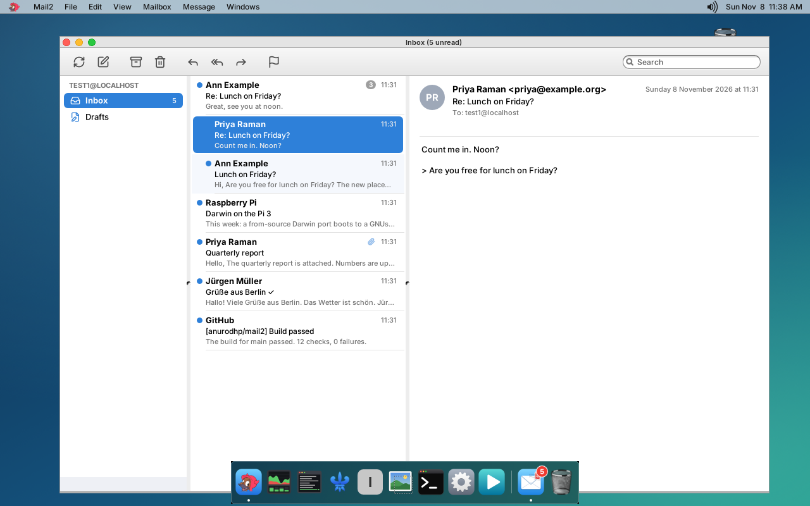
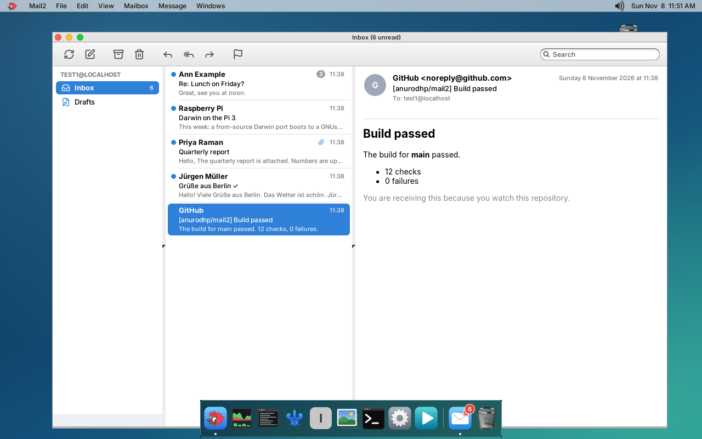

# Mail2

**A small IMAP mail client for GNUstep.** Mail2 is a mail app for the GNUstep + Window Maker desktop on the Raspberry Pi 3 port of Darwin (the sibling repository [iokit](https://github.com/anurodhp/xnu-iokit-pi3)), next to [Milan](https://github.com/anurodhp/milan), [Naples](https://github.com/anurodhp/naples), [Venice](https://github.com/anurodhp/venice), [Rome](https://github.com/anurodhp/rome) and [Florence](https://github.com/anurodhp/florence). It follows on from GNUstep's GNUMail, and is laid out like Apple Mail: mailboxes, the message list and the message, side by side. It is pure AppKit and libdispatch on top of libraries: [libetpan](https://github.com/dinhvh/libetpan) for IMAP, SMTP and MIME, SQLite for the message index and its full-text search, Maildir files for the messages, Mbed TLS for TLS, and for HTML mail [Florence](https://github.com/anurodhp/florence)'s WebKit (its shared `libFloWeb`), or libxml2 to turn it into text when Florence is not installed.



## Status

As of November 8, 2026 (version 0.4):

- **Works, tested against a real IMAP/SMTP server** (GreenMail, natively on the Mac, 110 checks in `tests/`): TLS with certificate checks, login, mailbox list with the special mailboxes found, the first sync and later ones, new mail pushed through IDLE, reading (plain text, HTML as text, attachments), read/unread and flags both ways, archive and delete (MOVE, or COPY + EXPUNGE), sending with SMTP (AUTH PLAIN/LOGIN), the Sent copy, the Maildir files and the index; and since 0.2 sending files (binary and non-ASCII names round trip), conversations (References), local and server search, fetching mail older than the first sync, and drafts saved, replaced and removed on the server; since 0.3 All Inboxes across two accounts, and OAuth: XOAUTH2 logins to IMAP and SMTP, token refresh (with Microsoft's refresh-token rotation), the device-code flow, the browser flow with PKCE, a revoked sign-in and Cancel, against a stand-in for the providers (`tests/oauth_mock.py`). TLS was also checked against `imap.gmail.com:993`.
- **Built for the Pi and run end to end under QEMU** on the real desktop (Window Maker, Naples, Milan): it syncs the Inbox from a server on the host, opens a conversation of three, shows a message and marks it read on the server, updates the dock badge, searches, reopens a draft with its attachment from the server's Drafts and sends it (the server receives it with `plan.pdf`, and Drafts is empty after), and sends a message typed into the compose window (`tools/qemu_shots.sh`, screenshots in `docs/`).
- **HTML mail in WebKit, under QEMU**: with Florence's engine copied into the image (`FLORENCE_DEPLOY=… tools/qemu_shots.sh`), an HTML message is drawn by WebKit in the message pane (`docs/qemu-html.png`). The first HTML message starts WebKit's processes; under QEMU that held the window for about 17 seconds, once. Not yet measured on the Pi.
- Things this port taught it: signals interrupt blocking calls on every thread (libetpan's own socket reads gave up on EINTR, so Mail2 has its own stream driver for plain connections too); GNUstep redraws only after an event (Mail2 posts one after background results); and GNUstep's Tab order is not used (the compose window and account panel set their own).
- **Runs on a real Pi 3** (November 8, 2026): deployed with Naples v0.10 and Florence's libFloWeb, it starts and shows its account panel on the Pi's own display (`docs/pi-account-panel.png`). Under QEMU the panels' contents never reached Xvfb's screen capture, although they were drawn: a limitation of the capture, not of Mail2.
- Not yet run against real accounts: nothing has signed in to Google or Microsoft for real (that needs client IDs registered with them, below).



## What you can do

- Add an IMAP account: the servers are filled in from the address (Gmail, iCloud, Fastmail, Yahoo, Outlook.com, else `imap.`/`smtp.` on its domain) and Sign In checks them before saving. TLS (993/465) or STARTTLS (143/587); plain only if you ask for it.
- Sign in with a password, or with **OAuth** for Google (Gmail, Google Workspace) and Microsoft (Outlook.com, Hotmail, Microsoft 365). Google opens its sign-in page in the browser; Microsoft shows a short code to enter at microsoft.com/devicelogin, on the Pi or on a phone. See "OAuth" below.
- Several accounts: Mail2 > Accounts… (Cmd-,) lists them with Add, Edit and Remove. With more than one there is an **All Inboxes** mailbox at the top, and Reply, Archive, Delete and the rest act on each message's own account.
- Three panes: mailboxes with unread counts (Inbox, Drafts, Sent, Archive, Junk, Trash first, found from the server's SPECIAL-USE flags or the usual names, then your folders), the messages of the mailbox (unread dot, flag, sender, date, subject, the opening lines, a paperclip for attachments), and the message (sender, subject, To and Cc, date, the body, attachments you can save).
- New mail arrives by itself (IMAP IDLE on the Inbox, plus a check every five minutes); Get Mail checks now.
- Reply, Reply All, Forward, New Message (plain text, UTF-8), with To, Cc and Bcc. Replies thread properly (In-Reply-To, References) and mark the original as answered.
- Addresses complete as you type in To, Cc and Bcc, from the people in your mail (senders, and whom you wrote to), the most frequent first; Tab, Return or a comma keeps the completion.
- A signature per account (Accounts… > Edit), added under `-- ` to new messages, replies and forwards, and swapped when you change From.
- Attach files (Attach… in the compose window or File > Attach File…; a click on a file's button takes it off). Forward sends the original's attachments along.
- Drafts: File > Save as Draft (Cmd-S), every minute while there are unsaved changes, and on closing (Save / Don't Save). They go to the server's Drafts mailbox (made if there is none), each save replacing the last; in Drafts, Return, a double click or Message > Edit Draft (Cmd-E) opens one again, Bcc and attachments included, and sending it removes it.
- Conversations: the list shows each conversation once, newest message first, with its count; selecting it opens it and lists its other messages under it (View > Organize by Conversation turns this off). Archive, Delete, Flag and Read on a closed conversation apply to all of it.
- Search (Edit > Find…, Cmd-F, or the field in the toolbar): sender, recipients, subject and the text of every downloaded message (SQLite full-text search), at once; then the server (IMAP SEARCH), which also finds mail older than what was synced.
- Older mail: scrolling to the end of the list fetches the 100 messages before it, again and again (Mailbox > Get Older Messages too).
- HTML mail is shown as it was meant to look, in WebKit, when Florence is installed (below); else as text.
- Move To… (Shift-Cmd-M), or drag messages onto a mailbox in the sidebar (within an account). Mark as Junk (Shift-Cmd-J) moves to Junk; in Junk it moves back to the Inbox.
- Folders: Mailbox > New Mailbox…, Rename Mailbox…, Delete Mailbox… (your own folders; names in any script, sent as IMAP's modified UTF-7; made under `INBOX.` on servers that keep folders there).
- Rules (Mail2 > Rules…): if From, To/Cc, Subject or any of them contains a text (case and accents ignored), move to a mailbox, mark as read, flag, or move to the Trash; per account or for all. They run on new Inbox mail, in order, a move ending the run, and Message > Apply Rules runs them on the selection.
- Archive (Gmail: All Mail), Delete (to the Trash; in the Trash, for good), Mark as Read/Unread, Flag. Changes show at once and reach the server in the background.
- The unread count of the Inbox on Mail2's icon in Naples' dock.
- `mailto:` links and `Mail2 mailto:someone@example.com` open a compose window.

## What you cannot do (yet)

- No rich text when writing: messages are plain text.
- Remote content in HTML mail (images and styles from the web) is not loaded unless you ask: a bar over such a message says so, and its Load Remote Content button loads them for that message, with Florence's content-blocker list applied so the trackers on it still do not load. `Mail2LoadRemoteContent YES` loads them always (with the list). JavaScript never runs. Inline images (`cid:`) are always shown. A list cannot know every sender's own tracking pixel, which is why loading stays off by default.
- Conversations are made from References and In-Reply-To only; a reply from a program that sends neither stands alone. They are per mailbox (a conversation does not pull in your replies from Sent).
- No address book beyond completing from your mail. Rules have one condition each. Search in All Inboxes covers what is downloaded (the server search is per mailbox).
- OAuth needs client IDs of your own (below). Yahoo, iCloud and others still sign in with an app password.
- Passwords and OAuth refresh tokens are kept in `~/GNUstep/Library/Mail2/Accounts.plist` (mode 600): there is no keychain on this system.
- Emoji (outside the BMP) show as `?`, as in Milan.
- A connection the server has closed while idle is noticed on the next command, which is then retried on a fresh connection (a moment's delay).
- Building needs a Mac and the iokit toolchain. There is no prebuilt package.

## How it works

- **Network**: each account has a serial dispatch queue that owns one IMAP connection (libetpan's `mailimap`); every command runs there, in order. A second connection IDLEs on the Inbox in a thread of its own and asks the queue to sync when the server reports a change. Results come back to the main thread with `performSelectorOnMainThread:` (the main dispatch queue does not wake GNUstep's run loop) as notifications the window listens to.
- **TLS**: libetpan does TLS with OpenSSL or GnuTLS, which this system does not have. It takes any transport as a `mailstream_low` driver, so `Mail2TLS.c` is one on Mbed TLS (the library curl uses here), verifying against `/etc/ssl/cert.pem` and the host name. STARTTLS swaps the plain driver for it on the same socket.
- **SMTP login**: libetpan's SMTP AUTH goes through Cyrus SASL, which this system does not have either; `Mail2SMTP.m` sends AUTH PLAIN or LOGIN itself on libetpan's stream.
- **Store**: `~/GNUstep/Library/Mail2/Index.sqlite` has a row per mailbox (UIDVALIDITY, UIDNEXT) and per message (envelope, flags, snippet, and the name of its file). A message, once downloaded, is a file in a Maildir per mailbox, `Mail/<account>/<mailbox>/cur/<uidvalidity>_<uid>.mail2:2,<flags>`, renamed when its flags change. The list reads only the index.
- **Sync**: the first time, the UIDs of the last 30 days (`UID SEARCH SINCE`), then envelopes, flags, sizes and BODYSTRUCTURE in batches of 100, newest first. After that, only UIDs above the highest one known, and the flags of the known ones (`UID FETCH n:* FLAGS`), which also shows what was deleted elsewhere. A changed UIDVALIDITY drops the mailbox's copy. The 25 newest messages under 512 KB are downloaded after each sync, for their opening lines and quick reading; the rest when you open them.
- **Reading**: libetpan's MIME parser; charsets are converted with iconv. With Florence installed, the HTML part is shown in a `FloWebView` from `libFloWeb`: Mail2 `dlopen()`s it the first time it shows an HTML message, so it starts no WebKit until then and nothing at all without Florence, and the library's code is shared with Florence. The view is sealed: no JavaScript (not even `<script>` parsing), an ephemeral network session whose every request goes to a proxy that does not exist (nothing remote loads, so no read receipts by tracking pixel), `cid:` images served from the message, and a clicked link opens in Florence (`mailto:` in a compose window). Without Florence, the plain part is shown (`Mail2PreferPlainText`) or the HTML through libxml2's HTML parser as text. Text is drawn with Milan's per-run font fallback, so names and subjects in other scripts show.
- **Conversations and search**: each message's row gets a conversation key when it arrives (the key of a known message it refers to or that refers to it, else the first id it refers to, else its own Message-ID), so the list is one query (SQLite window functions). Downloaded bodies go into an FTS4 table; a search is a `LIKE` over the envelope plus a `MATCH` of word prefixes, then IMAP `UID SEARCH TEXT`, whose matches without a row get one.
- **Badge**: after every change Mail2 posts the distributed notification `NaplesBadgeChanged` with the unread count of its Inboxes; Naples draws it on the icon and clears it when Mail2 quits.

## OAuth

Google and Microsoft give access to mail only to applications registered with them, so Mail2 uses client IDs you register (free; they are not shipped in Mail2):

- **Google**: in the Google Cloud console, create a project, enable the Gmail API, set up the OAuth consent screen (add yourself as a test user while it is in testing), and create an OAuth client of type *Desktop app*. Then `defaults write Mail2 Mail2GoogleClientID <client id>` and `defaults write Mail2 Mail2GoogleClientSecret <client secret>` (Google calls a desktop app's secret not secret; it is required all the same). Mail2 asks for the scope `https://mail.google.com/`, the one IMAP and SMTP accept.
- **Microsoft**: in Microsoft Entra (portal.azure.com, App registrations), register an application for *personal Microsoft accounts and any organizational directory*, turn on *Allow public client flows* (Authentication), and add the delegated permissions `IMAP.AccessAsUser.All`, `SMTP.Send` and `offline_access` (Office 365 Exchange Online). Then `defaults write Mail2 Mail2MicrosoftClientID <application id>`. Microsoft 365 tenants must also allow SMTP AUTH for the mailbox.

How it works: Google's sign-in is the authorization-code flow with PKCE, the browser coming back to a one-time listener on 127.0.0.1 (Google does not allow the mail scope in its device flow). Microsoft's is the device-code flow. Either ends with a refresh token, stored with the account; access tokens are fetched when needed (HTTPS through Mail2's own Mbed TLS stream) and kept in memory until a minute before they expire. IMAP logs in with `AUTHENTICATE XOAUTH2`, SMTP with `AUTH XOAUTH2`. Microsoft's new refresh token after each renewal is saved at once. A revoked sign-in shows as an error naming the account; Edit it in Accounts… to sign in again.

## Building

You need a Mac with **Xcode 12** (the iPhoneOS SDK the port is built with) and a current Xcode for its linker, and the [iokit](https://github.com/anurodhp/xnu-iokit-pi3) repository checked out next to this one (`../iokit`, or set `IOKIT_DIR`) with its toolchain, X11 and GNUstep built, and Mbed TLS (`build_mbedtls.sh`). Then:

```sh
./build.sh            # builds libetpan and SQLite if needed (iokit's build_libetpan.sh, build_sqlite.sh), then Mail2.app
./build.sh deploy     # build, then copy Mail2.app, libetpan, SQLite and Mbed TLS to the Pi
```

`deploy` uses `DEPLOY_HOST` (default `root@10.0.0.142`). The dock badge needs Naples v0.10 or later. HTML mail in WebKit needs Florence with `libFloWeb` (Florence after v0.3.0) deployed on the Pi; without it Mail2 shows HTML as text.

## Testing

```sh
tests/run_host_tests.sh   # the mail core, natively on the Mac, against GreenMail (needs java and cmake)
tools/qemu_shots.sh       # the app on the Darwin desktop under QEMU, syncing from GreenMail on the host; screenshots in docs/
```

`run_host_tests.sh` builds libetpan and Mbed TLS for the host from iokit's pinned sources and compiles Mail2's own core files (TLS, IMAP, SMTP, MIME, store, session) with Apple's Foundation, then runs `tests/core_test.m`: header decoding, building and sending a message, IMAP login, list, search, fetch, MIME and HTML parsing, the Maildir and index, flags, MOVE, EXPUNGE, IDLE, and the session's sync, push and local-first changes. GreenMail (a Java test server) is fetched once, pinned by checksum.

On the Pi, `MAIL2_DEBUG=1 /Applications/Mail2.app/Mail2` logs the IMAP and SMTP conversation (passwords are left out).

## Defaults

| Default | What |
|---|---|
| `Mail2SyncDays` | days of mail fetched when a mailbox is first opened (30) |
| `Mail2ShowHTML` | `NO`: never use WebKit, show HTML mail as text (default `YES`) |
| `Mail2PreferPlainText` | without WebKit: `NO` shows the HTML part, as text, when a message has both (default `YES`) |
| `Mail2Conversations` | `NO`: one row per message (View > Organize by Conversation) |
| `Mail2LoadRemoteContent` | `YES`: load HTML mail's images and styles from the web without asking (Florence's tracker list still applies; default `NO`) |
| `Mail2GoogleClientID`, `Mail2GoogleClientSecret` | your Google OAuth client (see OAuth) |
| `Mail2MicrosoftClientID` | your Microsoft OAuth application (see OAuth) |
| `Mail2Debug` | `YES` logs the IMAP and SMTP conversation (also `MAIL2_DEBUG=1`) |

`MAIL2_FLOWEB` in the environment points at another `libFloWeb.1.dylib` than `/usr/local/lib`'s.

## Layout

| | |
|---|---|
| `main.m` | application, menus, accounts |
| `Mail2Window.m`, `Mail2Views.m` | the viewer: toolbar, the three panes, the row and header drawing |
| `Mail2Compose.m`, `Mail2AccountPanel.m` | the compose window, the account panel and the Accounts window |
| `Mail2Session.m` | an account's queue, sync, IDLE thread, local-first changes, the dock badge |
| `Mail2IMAP.m`, `Mail2SMTP.m`, `Mail2TLS.c` | IMAP and SMTP over libetpan, TLS on Mbed TLS |
| `Mail2Message.m` | reading (MIME, HTML to text) and building messages |
| `Mail2Store.m` | the SQLite index and the Maildir files |
| `Mail2Account.m`, `Mail2Util.m`, `MilanText.m` | settings, helpers, font fallback (from Milan) |
| `Mail2Rules.m`, `Mail2RulesWindow.m` | rules for new mail, and their window |
| `Mail2OAuth.m` | OAuth sign-in (browser with PKCE, device code), token refresh, the small HTTPS client |
| `icons/`, `tools/make_icons.sh`, `tools/make_icon.m` | Lucide glyphs, the envelope-and-stamp app icon, and their generators |
| `tests/` | the host test of the mail core |
| `tools/qemu_shots.sh` | the QEMU end-to-end run |
| `docs/plan.md` | the plan |

## Licence

MIT, see `LICENSE`. The icons are Lucide (ISC). Mail2 links libetpan (BSD-3-Clause), SQLite (public domain), Mbed TLS (Apache-2.0) and libxml2 (MIT), which keep their own licences.
